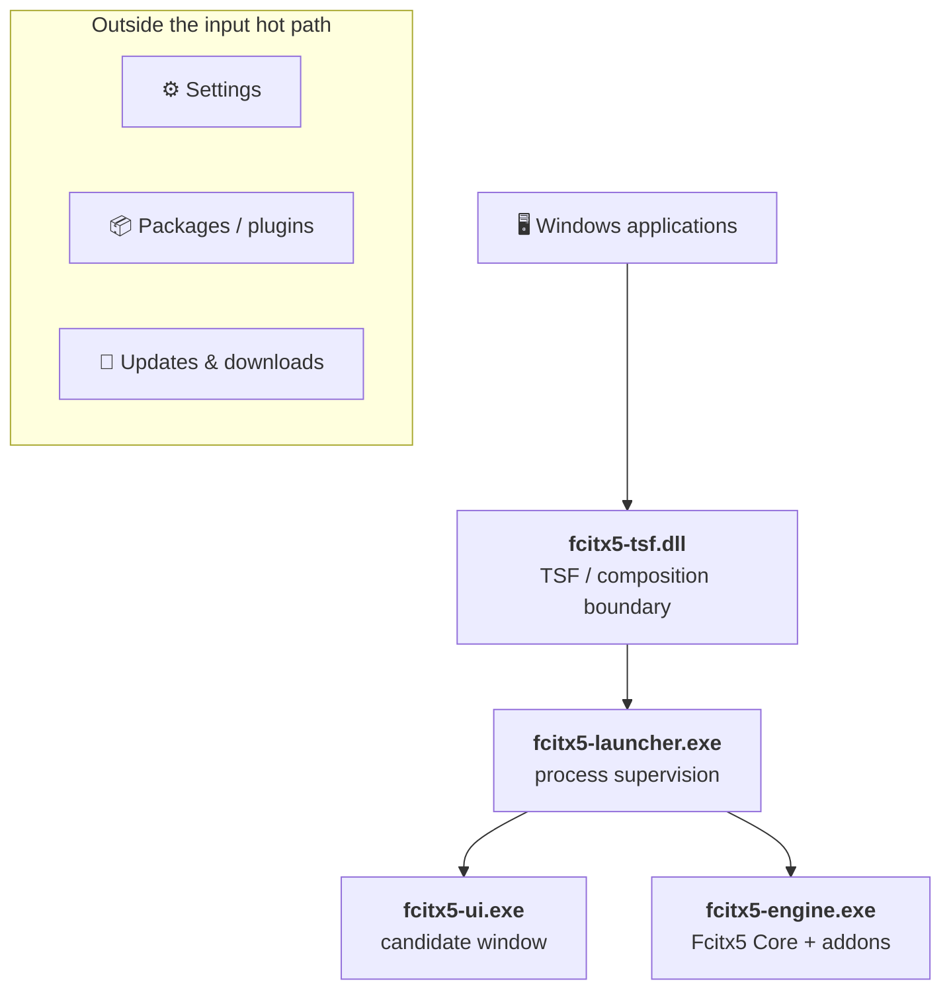

<div align="center">



<h3>Fcitx5, natively integrated with Windows.</h3>

<p>One system-level TSF entry, the full Fcitx5 Core and addon ecosystem behind it,<br>and a native candidate window, settings and package manager written in Rust.</p>

[](https://github.com/0x696c757a696f/fcitx5-windows-next/releases)
[](https://github.com/0x696c757a696f/fcitx5-windows-next/actions/workflows/core.yml)
[](#-status)
[](LICENSE)
<br>
[](#-architecture)
[](rust-toolchain.toml)
[](#-build-from-source)
[](https://github.com/fcitx/fcitx5)
[](https://github.com/0x696c757a696f/fcitx5-windows-next/releases)

**English** · [简体中文](README.zh-CN.md)

<a href="https://github.com/0x696c757a696f/fcitx5-windows-next/releases"></a>

[Highlights](#-highlights) · [Candidate window](#-candidate-window) · [Download](#-download-and-install) · [Architecture](#-architecture) · [Configuration](#-configuration) · [Build](#-build-from-source) · [Code signing](#-code-signing-policy) · [Sponsor](#-sponsor)

</div>

> [!WARNING]
> **Developer Preview:** built for development and evaluation, and not yet through every release gate. See [Status](#-status).

## ✨ Highlights

<table>
<tr>
<td width="33%" valign="top">

### 🐧 Real Fcitx5
Input behavior comes straight from **Fcitx5 Core** and its addon ecosystem: Rime, Pinyin, Mozc and more. Not a rewrite, not an imitation.

</td>
<td width="33%" valign="top">

### 🪟 One TSF entry
Windows sees **one** product-level input method instead of a TSF profile per addon. Switching schemes is Fcitx's job.

</td>
<td width="33%" valign="top">

### 🦀 Rust-owned
TSF, candidate window, settings, launcher, packages and updates are Rust. C++ stays a thin adapter around Fcitx objects.

</td>
</tr>
<tr>
<td valign="top">

### ⚡ Lean hot path
The keystroke path is bounded and fail-open. Network, downloads and updates live outside it and never see your keystrokes or commit history.

</td>
<td valign="top">

### 🎨 Native candidate UI
DirectWrite rendering, per-monitor DPI scaling, follows the system light/dark mode, with rounded corners, shadow and opacity.

</td>
<td valign="top">

### 📦 Rollback-safe packages
Plugins and updates activate transactionally and can roll back. Repository verification, network and signatures stay out of Settings.

</td>
</tr>
</table>

## 🎯 Candidate window

Real screenshots of the candidate window; light or dark follows your GitHub theme.

<picture>
  <source media="(prefers-color-scheme: dark)" srcset="docs/assets/candidate-layouts-dark.png">
  
</picture>

**Scroll mode, expanded.** With a long candidate list, the scroll layout opens into a grid you move through with the arrow keys, PageUp / PageDown and Home / End.

<table>
<tr>
<td width="50%" align="center">

<picture>
  <source media="(prefers-color-scheme: dark)" srcset="docs/assets/candidate-scroll-rows-dark.png">
  
</picture>
<br><sub>Horizontal: rows of one page</sub>

</td>
<td width="50%" align="center">

<picture>
  <source media="(prefers-color-scheme: dark)" srcset="docs/assets/candidate-scroll-expanded-dark.png">
  
</picture>
<br><sub>Vertical: columns of one page</sub>

</td>
</tr>
</table>

<sub>Captured from the built `fcitx5-ui.exe --demo` by the [README Screenshots](.github/workflows/readme-screenshots.yml) workflow.</sub>

Candidate semantics, model and layout are implemented in Rust; Fcitx remains the single source of input semantics.

<details>
<summary><b>All layouts and label styles</b></summary>

| Layout | `layout_type` | Behavior |
| :-- | :-- | :-- |
| Automatic | `automatic` | Horizontal with paging; falls back to vertical when it does not fit the screen |
| Stacked | `stacked` | Classic vertical list with paging |
| Flow | `flow` | Horizontal, wraps when wider than the window |
| Scroll | `scroll` | Continuous horizontal or vertical scrolling; arrows / PageUp / PageDown / Home / End follow the layout axis |
| Vertical text | `vertical_text` | Vertically written candidates, columns right-to-left or left-to-right |

Label styles: `plain`, `dot`, `paren`, `bracket`, `circled`. They change only the look, never the selection keys.

</details>

## 📥 Download and install

Get the files from [**Releases**](https://github.com/0x696c757a696f/fcitx5-windows-next/releases). Windows 10 / 11, x64; 32-bit applications are supported too.

| File | What it is | Pick it if |
| :-- | :-- | :-- |
| `fcitx5-windows-<version>-setup.exe` | **Installer** (recommended). Installs to `Program Files\Fcitx5` and registers the input method. | You want a normal install |
| `fcitx5-windows-<version>-portable.zip` | **Portable build.** Extract anywhere and run `Start Fcitx5.exe`; settings stay in that folder. | You want to try it without installing |
| `*.fcpkg` | **Plugins** such as Rime, Mozc, Chewing and Wubi. | You do not need to download these: install them from **Fcitx5 Settings → Add-ons & Extensions** |

Every release page lists each file, including the plugin catalog and the signature, SBOM and provenance files, with what it is for and how to verify it.

1. Run the installer, or extract the portable ZIP and start `Start Fcitx5.exe` (it asks once for administrator approval to register the input method).
2. Switch to **Fcitx5** with <kbd>Win</kbd> + <kbd>Space</kbd>.
3. Open **Fcitx5 Settings** to add input methods, install plugins and pick a theme.

<details>
<summary><b>Preview builds from <code>main</code></b></summary>

Every push to `main` runs the [Preview Package](https://github.com/0x696c757a696f/fcitx5-windows-next/actions/workflows/preview-package.yml) workflow; its developer-preview packages are attached to each run as artifacts. They are unsigned and meant for testing.

</details>

## 🧭 Architecture



Settings, package management, updates and downloads live outside the live input path. They do not receive live keystrokes, preedit text, candidate state or commit history from input sessions.

## 📝 Configuration

User settings are a commented TOML file; anything you leave out inherits from the current theme. Settings writes the same file, so you rarely need to edit it by hand.

<details>
<summary><b>Example <code>config.toml</code></b></summary>

See [`resources/config.toml`](resources/config.toml) for every option.

```toml
[appearance]
mode = "system"            # system | light | dark, applied live

[candidate]
layout_type = "scroll"     # automatic | stacked | flow | scroll | vertical_text
scroll_direction = "horizontal"
page_size = 5              # 1–9
opacity = 1.0              # 0.20–1.00
preedit_mode = "inline"    # inline (in the app) | panel (top of candidate window)

[candidate.label]
style = "dot"              # plain | dot | paren | bracket | circled

[fonts.candidate]
families = ["Microsoft YaHei", "system"]
size_dip = 18.0
```

</details>

## 🔧 Build from source

<details>
<summary><b>Requirements and commands</b></summary>

Requirements:

- Windows with Visual Studio 2022 C++ x86/x64 tools and ATL (`Microsoft.VisualStudio.Component.VC.ATL`)
- CMake 3.29 or newer
- PowerShell 7

The repository bootstrap manages the pinned Rust and supporting toolchains; you do not need to install them by hand.

```powershell
./tools/build.ps1 bootstrap
./tools/build.ps1 dev  -Architecture x64
./tools/build.ps1 test -Architecture x64
```

Produce local release-shaped packages (x64, x86, ARM64):

```powershell
./tools/build.ps1 package -Architecture all -Configuration Release
```

This produces local package artifacts; it is not equivalent to the protected signing and publication release gate.

</details>

## 🧪 Status

Releases are published as pre-releases while the remaining release evidence is collected.

<details>
<summary><b>What automated tests alone do not establish</b></summary>

- real-host typing, accessibility, or UAC/install lifecycle;
- protected production signing;
- the online package/plugin lifecycle;
- the declared Windows compatibility matrix.

The declared Windows compatibility matrix is not yet release-qualified across the required real-host environments. See [`docs/host-compatibility-matrix-2026-08-20.md`](docs/host-compatibility-matrix-2026-08-20.md) for the evidence record.

</details>

<details>
<summary><b>Repository layout and documentation</b></summary>

| Path | Contents |
| :-- | :-- |
| [`rust/`](rust) | Windows product logic and shipping Rust components |
| [`native-engine/`](native-engine), [`src/`](src) | Fcitx-facing and native adapter boundaries |
| [`resources/`](resources) | Branding icons, themes and default configuration |
| [`tools/`](tools) | Bootstrap, build, test, package and release tooling |
| [`docs/`](docs) | Contracts, verification matrices and engineering evidence |

- [`docs/current.md`](docs/current.md): current implementation and evidence truth
- [`docs/product-contract.md`](docs/product-contract.md): product and architecture contract
- [`docs/tasks/current.md`](docs/tasks/current.md): current bounded task
- [`SECURITY.md`](SECURITY.md): security model and reporting
- [`THIRD_PARTY_NOTICES.md`](THIRD_PARTY_NOTICES.md): dependency notices
- [`AGENTS.md`](AGENTS.md): contributor instructions

</details>

## 🔏 Code signing policy

Free code signing provided by [SignPath.io](https://about.signpath.io/), certificate by [SignPath Foundation](https://signpath.org/).

Only binaries built by this repository's GitHub Actions release workflow from its public source are signed: the installer, the portable ZIP, the executables and DLLs inside them, and the plugin packages built from [our fork of the Fcitx5 addons](https://github.com/0x696c757a696f/fcitx5-plugins).

| Role | Members |
| --- | --- |
| Committers and reviewers | [@0x696c757a696f](https://github.com/0x696c757a696f) |
| Approvers | [@0x696c757a696f](https://github.com/0x696c757a696f) |

Every release signing request is approved manually by an approver.

### Privacy

This program will not transfer any information to other networked systems unless specifically requested by the user or the person installing or operating it. When you check for updates or install, update or refresh plugins, it downloads the release metadata and packages from GitHub Releases; GitHub's [privacy statement](https://docs.github.com/site-policy/privacy-policies/github-general-privacy-statement) applies to those requests. Nothing you type is ever sent anywhere.

## 💖 Sponsor

If this project is useful to you, donations help cover build machines, test devices and development time.

**Ethereum and EVM chains** (ETH or the chain's native coin, USDC, USDT): `0x619FeeF5986b9ed8E75D7CFD67AdB575355b9F80`

<details>
<summary><b>All networks and addresses</b></summary>

| Network | Assets | Address |
| --- | --- | --- |
| **Ethereum and EVM chains**<br><sub>Ethereum, Arbitrum One, Base, Optimism, Polygon, BNB Smart Chain</sub> | ETH or the chain's native coin, USDC, USDT | `0x619FeeF5986b9ed8E75D7CFD67AdB575355b9F80` |
| **Bitcoin · Taproot** | BTC | `bc1p7jf7pzep76cld4pd6xmtfjckpn6qamdqc2rhjus64re2cvuc72sqdwszqc` |
| **Bitcoin · Native SegWit** | BTC | `bc1q4rp3ag5lmnyy8eqwjm9s4xx62uulfr6n43ycvc` |
| **Bitcoin · Nested SegWit** | BTC | `3Lu1yzQYfNZLpvh2dt6T6NuRbtwQkJHmT6` |
| **Bitcoin · Legacy** | BTC | `123mpbi91xQitVkh9oosY4VczFqJB9kjDQ` |
| **TRON (TRC-20)** | USDT | `TBHXcP2ReM5sqpRDTyrL1UWtcSmYeyrmnB` |
| **Solana (SPL)** | USDT | `4s6uaauKCgwSNVzb5Lq1kxUe9dpm8V64D6FPw7hTwrQ6` |

</details>

> [!CAUTION]
> The EVM address is the same on every chain listed in its row; each other address only works on its own network. Pick the same network in your wallet or exchange before sending: assets sent on any other network may be lost. Any of the four Bitcoin addresses can receive BTC; use whichever format your wallet supports. Check that the address matches character for character before confirming.

## 📄 License

The root project is released under **GNU GPL version 3 or any later version**; see [`LICENSE`](LICENSE). Some reusable Rust crates declare `LGPL-2.1-or-later`, and third-party components retain their own terms. The applicable license for each component is defined by its license files and [`THIRD_PARTY_NOTICES.md`](THIRD_PARTY_NOTICES.md).

<div align="center">
<sub>The Fcitx5 input method framework is maintained by the <a href="https://github.com/fcitx/fcitx5">fcitx community</a>; this project is its Windows frontend and distribution layer.</sub>
</div>
