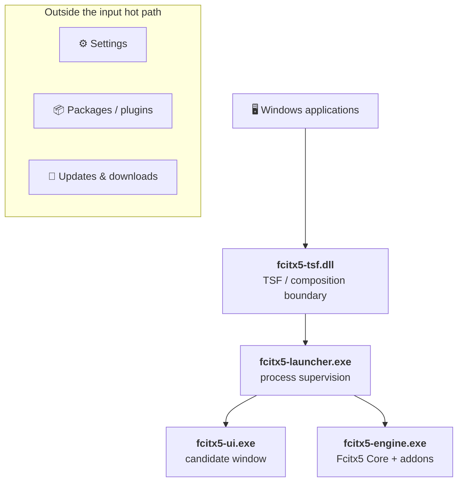

<div align="center">


<h3>Fcitx5, natively integrated with Windows.</h3>

<p>One system-level TSF entry, the full Fcitx5 Core and addon ecosystem behind it,<br>and a native candidate window, settings and package manager written in Rust.</p>

[](https://github.com/0x696c757a696f/fcitx5-windows-next/actions/workflows/core.yml)
[](#-status)
[](LICENSE)
<br>
[](#-architecture)
[](rust-toolchain.toml)
[](#-build-from-source)
[](https://github.com/fcitx/fcitx5)

**English** · [简体中文](README.zh-CN.md)

[Highlights](#-highlights) · [Candidate window](#-candidate-window) · [Architecture](#-architecture) · [Quick start](#-quick-start) · [Configuration](#-configuration) · [Docs](#-documentation)

</div>

> [!WARNING]
> **Developer Preview:** This project is for development and evaluation. Local builds and automated tests do not by themselves establish release readiness. See [Status](#-status).

## ✨ Highlights

<table>
<tr>
<td width="33%" valign="top">

### 🐧 Real Fcitx5
Input behavior comes straight from **Fcitx5 Core** and its addon ecosystem: Rime, Pinyin, Mozc and more. Not a rewrite, not an imitation.

</td>
<td width="33%" valign="top">

### 🪟 One TSF entry
Windows sees **one** product-level input method instead of a TSF profile per addon. Switching schemes is Fcitx's job.

</td>
<td width="33%" valign="top">

### 🦀 Rust-owned
TSF, candidate window, settings, launcher, packages and updates are Rust. C++ stays a thin adapter around Fcitx objects.

</td>
</tr>
<tr>
<td valign="top">

### ⚡ Lean hot path
The keystroke path is bounded and fail-open. Network, downloads and updates live outside it and never see your keystrokes or commit history.

</td>
<td valign="top">

### 🎨 Native candidate UI
DirectWrite rendering, per-monitor DPI scaling, follows the system light/dark mode, with rounded corners, shadow and opacity.

</td>
<td valign="top">

### 📦 Rollback-safe packages
Plugins and updates activate transactionally and can roll back. Repository verification, network and signatures stay out of Settings.

</td>
</tr>
</table>

## 🎯 Candidate window

Candidate semantics, model and layout are implemented in Rust; Fcitx remains the single source of input semantics.

| Layout | `layout_type` | Behavior |
| :-- | :-- | :-- |
| Automatic | `automatic` | Horizontal with paging; falls back to vertical when it does not fit the screen |
| Stacked | `stacked` | Classic vertical list with paging |
| Flow | `flow` | Horizontal, wraps when wider than the window |
| Scroll | `scroll` | Continuous horizontal or vertical scrolling; arrows / PageUp / PageDown / Home / End follow the layout axis |
| Vertical text | `vertical_text` | Vertically written candidates, columns right-to-left or left-to-right |

Label styles: `plain`, `dot`, `paren`, `bracket`, `circled`. They change only the look, never the selection keys.

## 🧭 Architecture



Settings, package management, updates and downloads live outside the live input path. They do not receive live keystrokes, preedit text, candidate state or commit history from input sessions.

## 🚀 Quick start

### Download a preview build

Every push to `main` runs the [Preview Package](https://github.com/0x696c757a696f/fcitx5-windows-next/actions/workflows/preview-package.yml) workflow; developer-preview packages are attached to each run as artifacts. There is no official release yet.

### 🔧 Build from source

Requirements:

- Windows with Visual Studio 2022 C++ x86/x64 tools and ATL (`Microsoft.VisualStudio.Component.VC.ATL`)
- CMake 3.29 or newer
- PowerShell 7

The repository bootstrap manages the pinned Rust and supporting toolchains; you do not need to install them by hand.

```powershell
./tools/build.ps1 bootstrap
./tools/build.ps1 dev  -Architecture x64
./tools/build.ps1 test -Architecture x64
```

Produce local release-shaped packages (x64, x86, ARM64):

```powershell
./tools/build.ps1 package -Architecture all -Configuration Release
```

This produces local package artifacts; it is not equivalent to the protected signing and publication release gate.

## 🛠️ Configuration

User settings are a commented TOML file; anything you leave out inherits from the current theme. See [`resources/config.toml`](resources/config.toml) for the full example.

```toml
[appearance]
mode = "system"            # system | light | dark, applied live

[candidate]
layout_type = "scroll"     # automatic | stacked | flow | scroll | vertical_text
scroll_direction = "horizontal"
page_size = 5              # 1–9
opacity = 1.0              # 0.20–1.00
preedit_mode = "inline"    # inline (in the app) | panel (top of candidate window)

[candidate.label]
style = "dot"              # plain | dot | paren | bracket | circled

[fonts.candidate]
families = ["Microsoft YaHei", "system"]
size_dip = 18.0
```

## 🧪 Status

The codebase has substantial automated and local verification, and a current-HEAD portable package can be built locally. It is still behind the release evidence gates.

<details>
<summary><b>What local tests alone do not establish</b></summary>

- real-host typing, accessibility, or UAC/install lifecycle;
- protected production signing or publication;
- the online package/plugin lifecycle;
- the declared Windows compatibility matrix;
- CI and release evidence.

The declared Windows compatibility matrix is not yet release-qualified across the required real-host environments. See [`docs/host-compatibility-matrix-2026-08-20.md`](docs/host-compatibility-matrix-2026-08-20.md) for the evidence record.

</details>

## 📁 Repository layout

| Path | Contents |
| :-- | :-- |
| [`rust/`](rust) | Windows product logic and shipping Rust components |
| [`native-engine/`](native-engine), [`src/`](src) | Fcitx-facing and native adapter boundaries |
| [`resources/`](resources) | Branding icons, themes and default configuration |
| [`tools/`](tools) | Bootstrap, build, test, package and release tooling |
| [`docs/`](docs) | Contracts, verification matrices and engineering evidence |

## 📚 Documentation

- [`docs/current.md`](docs/current.md): current implementation and evidence truth
- [`docs/product-contract.md`](docs/product-contract.md): product and architecture contract
- [`docs/tasks/current.md`](docs/tasks/current.md): current bounded task
- [`SECURITY.md`](SECURITY.md): security model and reporting
- [`THIRD_PARTY_NOTICES.md`](THIRD_PARTY_NOTICES.md): dependency notices
- [`AGENTS.md`](AGENTS.md): contributor instructions

## 📄 License

The root project is released under **GNU GPL version 3 or any later version**; see [`LICENSE`](LICENSE). Some reusable Rust crates declare `LGPL-2.1-or-later`, and third-party components retain their own terms. The applicable license for each component is defined by its license files and [`THIRD_PARTY_NOTICES.md`](THIRD_PARTY_NOTICES.md).

<div align="center">
<sub>The Fcitx5 input method framework is maintained by the <a href="https://github.com/fcitx/fcitx5">fcitx community</a>; this project is its Windows frontend and distribution layer.</sub>
</div>
