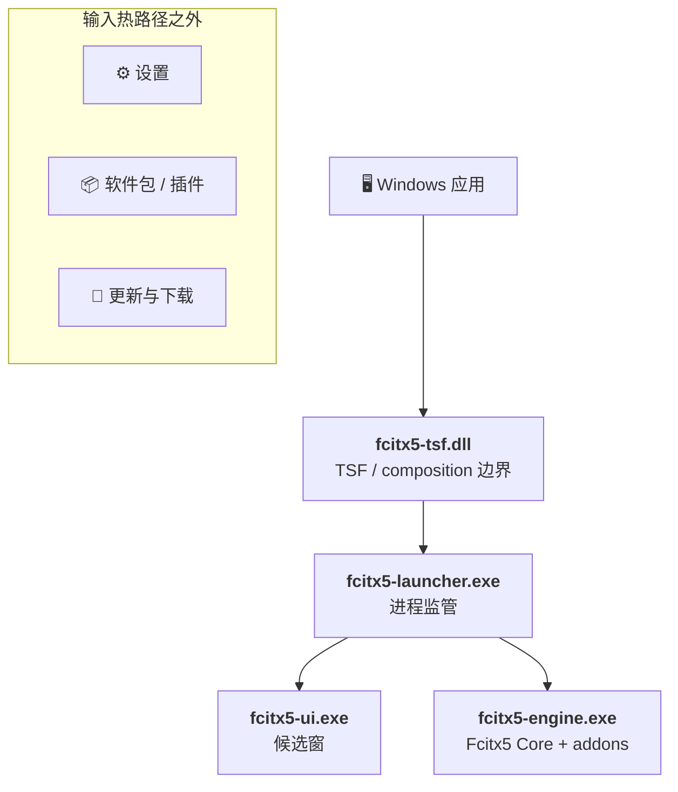

<div align="center">


<h3>让 Fcitx5 真正融入 Windows</h3>

<p>一个系统级 TSF 入口，背后是完整的 Fcitx5 Core 与插件生态，<br>外加用 Rust 打造的原生候选窗、设置与软件包管理。</p>

[](https://github.com/0x696c757a696f/fcitx5-windows-next/actions/workflows/core.yml)
[](#-当前状态)
[](LICENSE)
<br>
[](#-架构)
[](rust-toolchain.toml)
[](#-从源码构建)
[](https://github.com/fcitx/fcitx5)

[English](README.md) · **简体中文**

[亮点](#-亮点) · [候选窗](#-候选窗) · [架构](#-架构) · [快速开始](#-快速开始) · [配置](#-配置) · [文档](#-文档) · [代码签名](#-代码签名政策) · [捐助](#-捐助)

</div>

> [!WARNING]
> **开发者预览版：** 本项目用于开发和评估。仅凭本地构建和自动化测试，不能证明已经达到发行条件。详见[当前状态](#-当前状态)。

## ✨ 亮点

<table>
<tr>
<td width="33%" valign="top">

### 🐧 真正的 Fcitx5
输入法行为直接来自 **Fcitx5 Core** 和它的 addon 生态：Rime、拼音、Mozc……不是重写，也不是模仿。

</td>
<td width="33%" valign="top">

### 🪟 一个 TSF 入口
Windows 只看到**一个**产品级输入法，而不是每个 addon 一个 TSF 配置文件。切换方案交给 Fcitx。

</td>
<td width="33%" valign="top">

### 🦀 Rust 主导
TSF、候选窗、设置、启动器、软件包与更新逻辑由 Rust 掌控；C++ 只保留与 Fcitx 对象直接对接的薄适配层。

</td>
</tr>
<tr>
<td valign="top">

### ⚡ 热路径极简
按键路径有界、失败即放行（fail-open）。网络、下载与更新完全在输入热路径之外，拿不到你的按键和上屏历史。

</td>
<td valign="top">

### 🎨 原生候选窗
DirectWrite 渲染，按显示器 DPI 缩放，跟随系统浅色/深色模式，支持圆角、阴影与透明度。

</td>
<td valign="top">

### 📦 可回滚的软件包
插件与更新采用事务式激活，失败可回滚；仓库校验、网络与签名处理都与设置程序隔离。

</td>
</tr>
</table>

## 🎯 候选窗

候选窗的语义、模型与布局由 Rust 实现，Fcitx 仍是输入语义的唯一来源。

| 布局 | `layout_type` | 说明 |
| :-- | :-- | :-- |
| 自动 | `automatic` | 默认横排分页，屏幕放不下时自动退回竖排 |
| 堆叠 | `stacked` | 经典竖排列表，分页 |
| 流式 | `flow` | 横排，超出宽度自动换行 |
| 卷轴 | `scroll` | 横向或纵向连续滚动，方向键 / PageUp / PageDown / Home / End 按布局方向翻动 |
| 竖排文字 | `vertical_text` | 竖写候选，列从右到左或从左到右 |

序号样式可选 `plain`、`dot`、`paren`、`bracket`、`circled`，只改外观，不改选词按键。

## 🧭 架构



设置、软件包管理、更新与下载都位于输入路径之外，不接收会话中的实时按键、预编辑文本、候选状态或上屏历史。

## 🚀 快速开始

### 下载预览包

每次推送到 `main` 都会运行 [Preview Package](https://github.com/0x696c757a696f/fcitx5-windows-next/actions/workflows/preview-package.yml) 工作流，可以在对应运行的 Artifacts 中下载开发者预览包。目前还没有正式发布版。

### 🔧 从源码构建

需要：

- Windows，安装 Visual Studio 2022 C++ x86/x64 工具与 ATL（`Microsoft.VisualStudio.Component.VC.ATL`）
- CMake 3.29 或更新版本
- PowerShell 7

仓库的 bootstrap 会管理固定版本的 Rust 和配套工具链，不需要手动安装。

```powershell
./tools/build.ps1 bootstrap
./tools/build.ps1 dev  -Architecture x64
./tools/build.ps1 test -Architecture x64
```

生成本地发行形态的软件包（x64、x86、ARM64）：

```powershell
./tools/build.ps1 package -Architecture all -Configuration Release
```

这只会生成本地软件包，不等同于受保护的签名与发布流程。

## 🛠️ 配置

用户配置是一个带注释的 TOML 文件，未写出的字段继承当前主题。完整示例见 [`resources/config.toml`](resources/config.toml)。

```toml
[appearance]
mode = "system"            # system | light | dark，实时生效

[candidate]
layout_type = "scroll"     # automatic | stacked | flow | scroll | vertical_text
scroll_direction = "horizontal"
page_size = 5              # 1–9
opacity = 1.0              # 0.20–1.00
preedit_mode = "inline"    # inline（应用内）| panel（候选窗顶部）

[candidate.label]
style = "dot"              # plain | dot | paren | bracket | circled

[fonts.candidate]
families = ["Microsoft YaHei", "system"]
size_dip = 18.0
```

## 🧪 当前状态

代码库已有大量自动化和本地验证，也能在本地构建当前 HEAD 的便携包，但仍未通过发行证据门槛。

<details>
<summary><b>不能仅凭本地测试推断的内容</b></summary>

- 真实主机输入、无障碍和 UAC/安装生命周期；
- 受保护的生产签名或发布；
- 在线软件包 / 插件生命周期；
- 声明的 Windows 兼容性矩阵；
- CI 与发行证据。

声明的 Windows 兼容性矩阵尚未在所需的真实主机环境中完成发行级验证，证据记录见 [`docs/host-compatibility-matrix-2026-08-20.md`](docs/host-compatibility-matrix-2026-08-20.md)。

</details>

## 📁 仓库结构

| 目录 | 内容 |
| :-- | :-- |
| [`rust/`](rust) | Windows 产品逻辑和随产品发布的 Rust 组件 |
| [`native-engine/`](native-engine)、[`src/`](src) | 面向 Fcitx 的原生适配边界 |
| [`resources/`](resources) | 品牌图标、主题与默认配置 |
| [`tools/`](tools) | bootstrap、构建、测试、打包与发布工具 |
| [`docs/`](docs) | 契约、验证矩阵和工程证据 |

## 📚 文档

- [`docs/current.md`](docs/current.md)：当前实现与证据事实
- [`docs/product-contract.md`](docs/product-contract.md)：产品与架构契约
- [`docs/tasks/current.md`](docs/tasks/current.md)：当前有界任务
- [`SECURITY.md`](SECURITY.md)：安全模型与漏洞报告
- [`THIRD_PARTY_NOTICES.md`](THIRD_PARTY_NOTICES.md)：依赖声明
- [`AGENTS.md`](AGENTS.md)：贡献者说明

## 🔏 代码签名政策

Free code signing provided by [SignPath.io](https://about.signpath.io/), certificate by [SignPath Foundation](https://signpath.org/).（代码签名由 SignPath.io 免费提供，证书由 SignPath Foundation 签发。）

只有本仓库 GitHub Actions 发布流程从公开源码构建的文件会被签名：安装包、便携 ZIP、其中的可执行文件和 DLL，以及从[我们 fork 的 Fcitx5 插件仓库](https://github.com/0x696c757a696f/fcitx5-plugins)构建的插件包。

| 角色 | 成员 |
| --- | --- |
| 提交者与审查者 | [@0x696c757a696f](https://github.com/0x696c757a696f) |
| 签名批准者 | [@0x696c757a696f](https://github.com/0x696c757a696f) |

每次发布的签名请求都由批准者手动批准。

### 隐私

除非用户或安装、使用本程序的人明确要求，本程序不会向其他联网系统传输任何信息。检查更新，或安装、更新、刷新插件时，程序会从 GitHub Releases 下载发布信息和安装包，这些请求适用 GitHub 的[隐私声明](https://docs.github.com/site-policy/privacy-policies/github-general-privacy-statement)。你输入的任何内容都不会被发送出去。

## 💖 捐助

如果这个项目对你有帮助，欢迎捐助，用于支付构建机器、测试设备和开发时间。

| 网络 | 币种 | 地址 |
| --- | --- | --- |
| **以太坊及 EVM 链**<br><sub>Ethereum、Arbitrum One、Base、Optimism、Polygon、BNB Smart Chain</sub> | ETH 或该链原生币、USDC、USDT | `0x619FeeF5986b9ed8E75D7CFD67AdB575355b9F80` |
| **Bitcoin · Taproot** | BTC | `bc1p7jf7pzep76cld4pd6xmtfjckpn6qamdqc2rhjus64re2cvuc72sqdwszqc` |
| **Bitcoin · Native SegWit** | BTC | `bc1q4rp3ag5lmnyy8eqwjm9s4xx62uulfr6n43ycvc` |
| **Bitcoin · Nested SegWit** | BTC | `3Lu1yzQYfNZLpvh2dt6T6NuRbtwQkJHmT6` |
| **Bitcoin · Legacy** | BTC | `123mpbi91xQitVkh9oosY4VczFqJB9kjDQ` |
| **TRON (TRC-20)** | USDT | `TBHXcP2ReM5sqpRDTyrL1UWtcSmYeyrmnB` |
| **Solana (SPL)** | USDT | `4s6uaauKCgwSNVzb5Lq1kxUe9dpm8V64D6FPw7hTwrQ6` |

> [!CAUTION]
> EVM 地址在该行列出的所有链上通用；其余地址只适用于各自的网络。转账前请在钱包或交易所里选择相同的网络，选错网络的资产可能无法找回。四个比特币地址都可以接收 BTC，按你钱包支持的格式任选其一即可。确认前请逐字核对地址。

## 📄 许可证

根项目以 **GNU GPL 第 3 版或任何更新版本** 发布，见 [`LICENSE`](LICENSE)。部分可复用 Rust crate 声明为 `LGPL-2.1-or-later`，第三方组件保留各自条款。各组件适用的许可证以其许可证文件和 [`THIRD_PARTY_NOTICES.md`](THIRD_PARTY_NOTICES.md) 为准。

<div align="center">
<sub>Fcitx5 输入法框架由 <a href="https://github.com/fcitx/fcitx5">fcitx 社区</a> 维护；本项目是它的 Windows 前端与发行层。</sub>
</div>
